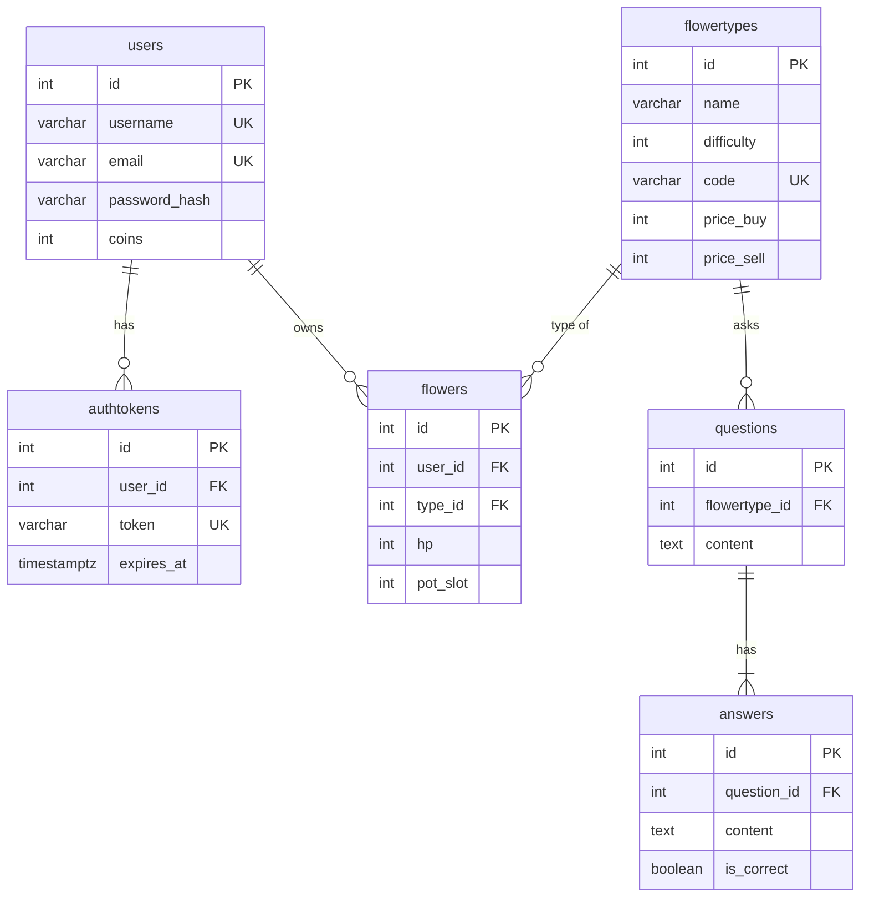

# 🌸 Flower Quiz — Оранжерея знаний

A gamified quiz web app: grow a home greenhouse by answering questions.
Every flower asks questions on its own subject. Correct answers "water" it and earn coins; mistakes make it wilt.

Built with **Blazor Server (.NET 7)** and **PostgreSQL**, shipped as Docker containers.

> Created as a group project practice at Perm State University (ПГНИУ), 2025.

## Features

- **Registration and login.** Accounts with unique usernames and emails, plus a login token kept in a cookie for 7 days.
- **Quiz gameplay.** Flowers in your pots periodically ask a question with 4 answers:
  - ✅ correct answer: **+5 coins**, flower gains 1 HP and grows
  - ❌ wrong answer: flower loses 1 HP and wilts (0 HP = dead)
- **Shop.** Buy seedlings of new flower types (up to 6 pots) and sell grown ones for coins.
- **12 flower types, 12 subjects.** Medicine, physics, biology, ecology, chemistry, poetry, climate, classic literature, zoology, history, chemical reactions and music.
- **Localization.** Russian and English UI.
- **Sound.** Background music and sound effects for answers.

| Flower | Subject |
|---|---|
| Алоэ медицины | Медицина |
| Кактус физики | Физика |
| Папоротник биологии | Биология |
| Мандариновое дерево экологии | Экология |
| Лук химии | Химия |
| Орхидея поэзии | Поэзия |
| Пальма климата | Климат |
| Фикус классики | Классическая литература |
| Зелёный хищник | Зоология |
| Роза бессмертия | История |
| Спатифиллум реакций | Химические реакции |
| Фиалка волны | Музыка |

## Quick start (Docker)

Requirements: [Docker](https://docs.docker.com/get-docker/) with Docker Compose.

```bash
git clone https://github.com/StrangeDroid/SiteDockerTest.git
cd SiteDockerTest
cp .env.example .env        # set your own DB password
docker compose up -d --build
```

Open **http://localhost:5273**.

This starts two containers:

| Service | Image | Purpose |
|---|---|---|
| `app` | built from `Dockerfile` | The Blazor web app (ports `5273`, `7041`) |
| `db` | `postgres:16-alpine` | Database, stored in the `db-data` volume |

On first start the database is created and filled automatically from `db/init/`:

| File | Contents |
|---|---|
| `01-schema.sql` | Tables, keys and constraints |
| `02-seed.sql` | The 12 flower types |
| `03-questions.sql` | Test questions in Russian (3 per flower) |

> The init scripts only run when the volume is empty. To recreate the database from scratch (**deletes all users and progress**):
> ```bash
> docker compose down -v && docker compose up -d
> ```

### Configuration

Set in `.env` (see `.env.example`):

| Variable | Default | Description |
|---|---|---|
| `POSTGRES_DB` | `flowers_db` | Database name |
| `POSTGRES_USER` | `flowers` | Database user |
| `POSTGRES_PASSWORD` | `flowers` | Database password, **change it for production** |

The app reads its connection string from `ConnectionStrings:Default`. Compose passes it as the `ConnectionStrings__Default` environment variable.

## Local development

Requirements: [.NET 7 SDK](https://dotnet.microsoft.com/download/dotnet/7.0) and Docker (for the database).

1. Expose the DB port by uncommenting `ports: - "5432:5432"` under `db` in `docker-compose.yml`, then start only the database:
   ```bash
   docker compose up -d db
   ```
2. Run the app (it uses the `localhost` connection string from `appsettings.Development.json`):
   ```bash
   cd BlazorApp1
   dotnet run
   ```

## Adding questions

Add lines to `db/init/03-questions.sql` (or create a new `04-*.sql` file):

```sql
-- add_q(flower_type_id, question, correct answer, wrong 1, wrong 2, wrong 3)
SELECT pg_temp.add_q(2, 'В каких единицах измеряется сила?', 'Ньютон', 'Джоуль', 'Ватт', 'Паскаль');
```

Answers are stored in random order, so the correct one isn't always first. Then recreate the database (see above).

## Database schema



## Project structure

```
├── BlazorApp1/
│   ├── Data/            # Models, DB connection factory, user repository
│   ├── Pages/           # Index (auto-login), RegistrationWindow, Game
│   ├── Resources/       # ru / en localization (.resx)
│   └── wwwroot/         # CSS, JS (cookies, audio), images, sounds
├── db/init/             # SQL run on first DB start
├── Dockerfile           # Multi-stage build of the app image
├── docker-compose.yml   # app + PostgreSQL
└── .github/workflows/   # Builds and pushes the image to GHCR
```

## CI

On every push to `master`, GitHub Actions builds the Docker image and publishes it to the GitHub Container Registry:

```
ghcr.io/strangedroid/sitedockertest:latest
```

## Tech stack

- C# / .NET 7, Blazor Server
- PostgreSQL 16 via [Npgsql](https://www.npgsql.org/)
- HTML, CSS, JavaScript
- Docker, Docker Compose, GitHub Actions

## Authors

Students of group ИТ/3 ФИТ-22-НБ, Faculty of Information Technologies, Perm State University:

- Юлия Голотина
- Кирилл Вешторт
- Юлия Худанина
